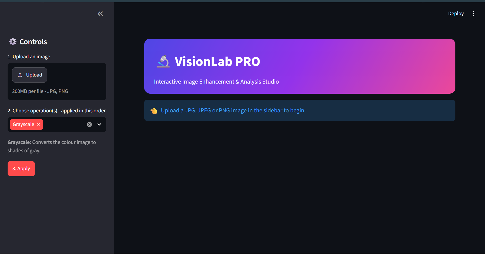
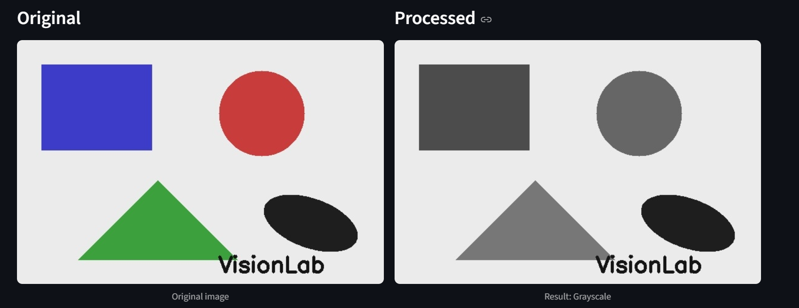

# VisionLab — Interactive Image Enhancement & Analysis Studio

VisionLab is a web application where a user uploads an image, applies one or
more image-processing algorithms, compares the original and processed images,
analyses the result, and downloads the output.

**Tech stack:** Python, OpenCV, NumPy, Pandas, Streamlit

## Features
- Upload JPG, JPEG or PNG images
- Six image-processing operations with adjustable settings (blur strength, Canny thresholds)
- **Filter chain:** apply several operations one after another (for example Median Filter → Grayscale → Canny)
- **Original vs processed** side-by-side comparison
- **Histogram view:** brightness histogram of the original and processed image
- **Blend slider:** fade smoothly between the original and the processed image
- **Smart Assistant:** measures brightness, contrast and noise, then recommends operations using simple rules (no AI model)
- Download the processed image as PNG
- Error handling for invalid uploads and wrong settings

## Algorithms
| Operation | Description |
|---|---|
| Grayscale | Converts a colour image to shades of gray. |
| Gaussian Blur | Smooths the image and reduces mild noise using a Gaussian kernel. |
| Median Filter | Replaces each pixel with the median of its neighbours; removes salt-and-pepper (impulse) noise. |
| Canny Edge Detection | Detects edges using image gradients and two thresholds (default 100 and 200). |
| Otsu Thresholding | Automatically picks the best threshold to create a black-and-white (binary) image. |
| Histogram Equalization | Improves contrast by spreading out pixel intensities (on the brightness channel for colour images). |

## How the Smart Assistant Works
The assistant calculates simple statistics from the image and applies rules:

| Measurement | Method | Rule |
|---|---|---|
| Brightness | Mean gray value | Very dark image → Histogram Equalization |
| Contrast | Standard deviation of gray values | Low contrast → Histogram Equalization |
| Impulse noise | % of pixels that differ strongly from their 3×3 median | High → Median Filter |
| Gaussian noise | Immerkaer's noise estimation method | High → Gaussian Blur |
| Clean image | None of the above | Suggests Canny Edge Detection |

## Installation
1. Install Python 3.9 or newer.
2. Clone this repository:
   ```
   git clone https://github.com/YOUR-USERNAME/YOUR-REPO.git
   cd YOUR-REPO
   ```
3. Install the libraries:
   ```
   pip install -r requirements.txt
   ```

## Run
```
streamlit run app.py
```
The app opens in your browser at `http://localhost:8501`.

## How to Use
1. Upload an image in the sidebar.
2. Choose one or more operations (they run in the order chosen) and adjust the sliders.
3. Click **Apply**.
4. Use the tabs: **Compare**, **Histogram**, **Blend slider** and **Smart Assistant**.
5. Click **Download processed image** to save the result.

## Testing
```
python test_image_processing.py
```
This runs all six algorithms on the images in `sample_images/` and checks that the
output is valid and the original image is never modified.

## Project Structure
```
VisionLab/
├── app.py                     # Streamlit interface
├── image_processing.py        # Image-processing algorithms
├── test_image_processing.py   # Tests for the algorithms
├── requirements.txt
├── README.md
├── .gitignore
├── sample_images/             # Images for testing
└── screenshots/               # Screenshots used in this README
```

## Screenshots



## Team Contributions
- **Astik** — Image-processing algorithms (`image_processing.py`), test script, Smart Assistant and extra features, documentation and GitHub upload.
- **Tanisha** — Streamlit interface (`app.py`), image comparison, download feature and UI testing.
